# Rack actuator

A 3D-printable rack-and-pinion linear actuator with **NEMA17 or NEMA14 drive**, **six 625ZZ guide bearings**, compliant rack teeth, and an enclosure with M3 heat-set mounting inserts. Choose **40, 100 or 150 mm stroke**, with an enclosed rack or a shorter rear pass-through housing.

**[Open the interactive CAD viewer](https://flex17-compliant-linear-actuator.seveibar.chatgpt.site/)** · **[Try the shorter enclosure](https://flex17-compliant-linear-actuator.seveibar.chatgpt.site/?motor=nema17&stroke=40&enclosure=pass-through)** · **[Explore NEMA14](https://flex17-compliant-linear-actuator.seveibar.chatgpt.site/?motor=nema14&stroke=40&enclosure=enclosed)** · **[Download CAD](https://flex17-compliant-linear-actuator.seveibar.chatgpt.site/?motor=nema17&stroke=40&enclosure=enclosed#files)**

[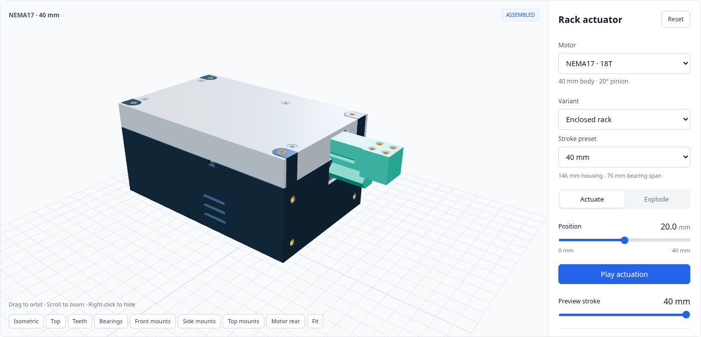](https://flex17-compliant-linear-actuator.seveibar.chatgpt.site/?motor=nema17&stroke=40&enclosure=enclosed)

The viewer provides actuation, a staged exploded assembly, right-click part hiding, mounting views, a resolution table, and preset-specific STEP/STL downloads. Screenshots and dimensions below show **CAD revision 24 at tooth module 2**. Click a screenshot to open its preset. Links select the motor, stroke and enclosure; camera angles, hidden parts and explosion stages are controlled inside the viewer.

[Models](#choose-a-model) · [Mechanism](#how-the-mechanism-works) · [Mounting](#mounting-the-module-and-its-load) · [Hardware & printing](#hardware-and-printing) · [Assembly](#assembly-and-service) · [Resolution](#resolution) · [Customize](#download-and-customize) · [Validation](#validation-and-practical-limits)

## Experimental worm drive

A separate **NEMA17 / 40 mm** direct worm-to-compliant-rack prototype is available in the [experimental viewer](https://flex17-compliant-linear-actuator.seveibar.chatgpt.site/experiments/worm-rack/). It uses a matched helical tooth profile, an open test fixture and a removable drive cartridge. Its single-start lead is 6.283 mm/rev, giving 18× finer command increments than the 18T spur drive. It has not been physically tested. See the [experiment notes, CAD source and test procedure](experiments/worm-rack/README.md). The twelve spur presets below are unchanged.

[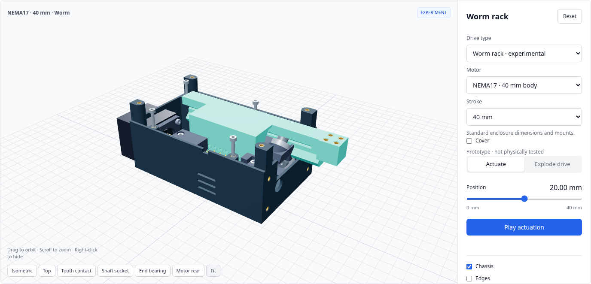](https://flex17-compliant-linear-actuator.seveibar.chatgpt.site/experiments/worm-rack/)

## Choose a model

All twelve combinations are generated and available to view and download:

| Motor | Stroke | Enclosed rack | Rear pass-through |
| --- | --- | --- | --- |
| NEMA17 | 40 mm | [View / download](https://flex17-compliant-linear-actuator.seveibar.chatgpt.site/?motor=nema17&stroke=40&enclosure=enclosed) | [View / download](https://flex17-compliant-linear-actuator.seveibar.chatgpt.site/?motor=nema17&stroke=40&enclosure=pass-through) |
| NEMA17 | 100 mm | [View / download](https://flex17-compliant-linear-actuator.seveibar.chatgpt.site/?motor=nema17&stroke=100&enclosure=enclosed) | [View / download](https://flex17-compliant-linear-actuator.seveibar.chatgpt.site/?motor=nema17&stroke=100&enclosure=pass-through) |
| NEMA17 | 150 mm | [View / download](https://flex17-compliant-linear-actuator.seveibar.chatgpt.site/?motor=nema17&stroke=150&enclosure=enclosed) | [View / download](https://flex17-compliant-linear-actuator.seveibar.chatgpt.site/?motor=nema17&stroke=150&enclosure=pass-through) |
| NEMA14 | 40 mm | [View / download](https://flex17-compliant-linear-actuator.seveibar.chatgpt.site/?motor=nema14&stroke=40&enclosure=enclosed) | [View / download](https://flex17-compliant-linear-actuator.seveibar.chatgpt.site/?motor=nema14&stroke=40&enclosure=pass-through) |
| NEMA14 | 100 mm | [View / download](https://flex17-compliant-linear-actuator.seveibar.chatgpt.site/?motor=nema14&stroke=100&enclosure=enclosed) | [View / download](https://flex17-compliant-linear-actuator.seveibar.chatgpt.site/?motor=nema14&stroke=100&enclosure=pass-through) |
| NEMA14 | 150 mm | [View / download](https://flex17-compliant-linear-actuator.seveibar.chatgpt.site/?motor=nema14&stroke=150&enclosure=enclosed) | [View / download](https://flex17-compliant-linear-actuator.seveibar.chatgpt.site/?motor=nema14&stroke=150&enclosure=pass-through) |

### Enclosure options

**Enclosed rack** keeps the toothed section inside the housing throughout normal travel; the smooth output tongue extends through the front. **Rear pass-through** removes the rear storage chamber and adds an opening for the rack and teeth. Both retain the same motor position, bearing stations, rack and usable stroke.

| Stroke | Enclosed housing length | Pass-through housing length | Length saved | Maximum rear projection |
| --- | --- | --- | --- | --- |
| 40 mm | 146 mm | 125 mm | 21 mm | 17 mm |
| 100 mm | 256 mm | 175 mm | 81 mm | 77 mm |
| 150 mm | 356 mm | 225 mm | 131 mm | 127 mm |

Housing width is **90.8 mm for NEMA17** and **84.8 mm for NEMA14**. The shorter housing still needs clearance for the rack's full swept travel. At module 2, its rear opening spans Y=15…41 mm and Z=−10…22 mm in CAD coordinates.

The following two screenshots use the **same 150 mm pass-through model and camera**, first fully retracted, then fully extended:

[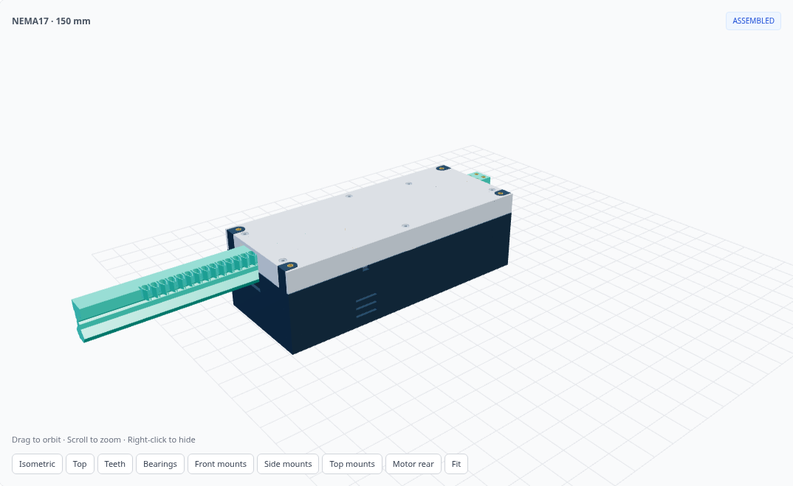](https://flex17-compliant-linear-actuator.seveibar.chatgpt.site/?motor=nema17&stroke=150&enclosure=pass-through)

[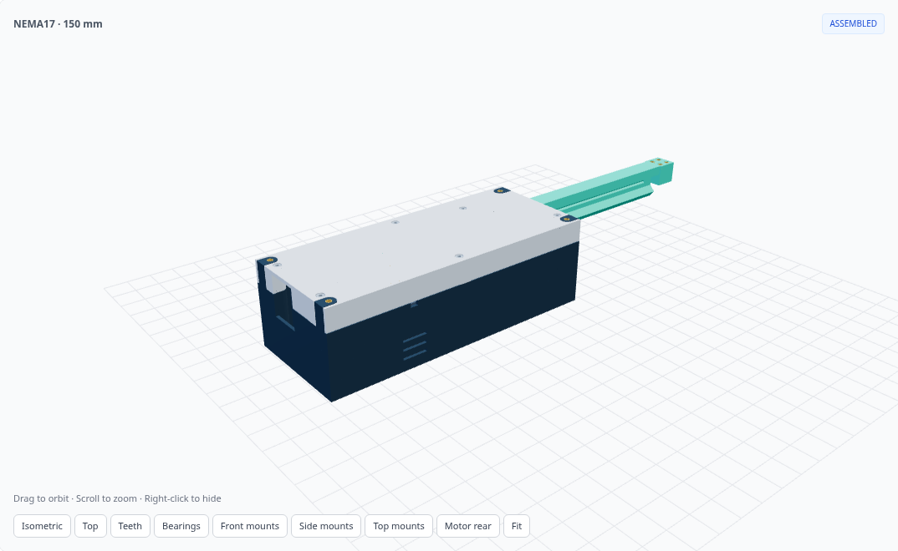](https://flex17-compliant-linear-actuator.seveibar.chatgpt.site/?motor=nema17&stroke=150&enclosure=pass-through)

[Try the 150 mm pass-through model](https://flex17-compliant-linear-actuator.seveibar.chatgpt.site/?motor=nema17&stroke=150&enclosure=pass-through) and drag **Position** between 0 and 150 mm, or select **Play actuation**.

Use the complete bundle for the selected motor, stroke and enclosure. Tray, lid, mounting coordinates and chassis clearance slots can differ between variants.

### NEMA17 versus NEMA14

| Default | NEMA17 | NEMA14 |
| --- | --- | --- |
| Reference motor body | 42 × 42 × 40 mm | 35.2 × 35.2 × 34 mm |
| Motor mounting pitch | 31 mm | 26 mm |
| Pinion | 18 teeth, 20° pressure angle | 14 teeth, 25° pressure angle |
| Tooth module | 2 mm | 2 mm |
| Travel per revolution | 113.097 mm | 87.965 mm |
| Housing width | 90.8 mm | 84.8 mm |

These are full-depth reference motors. The rear-mounted controller can remain outside the enclosure; its exact dimensions are not modeled. Verify the shaft, pilot and mounting dimensions of the motor you plan to use. The NEMA14 pinion gives a smaller commanded travel increment; motor torque and achievable accuracy depend on the actual hardware.

[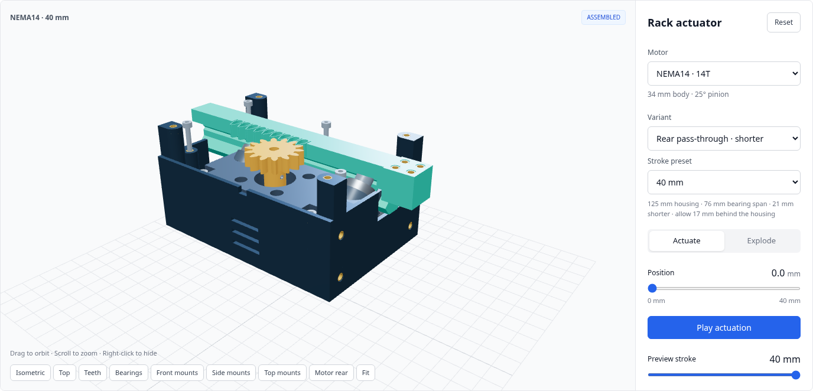](https://flex17-compliant-linear-actuator.seveibar.chatgpt.site/?motor=nema14&stroke=40&enclosure=pass-through)

## How the mechanism works

The pinion drives a compliant rack guided by two sets of three bearings. The chassis incorporates the motor mounting land and lower-bearing flexures. Five printed parts make up the module: **chassis, rack, pinion, tray and lid**.

[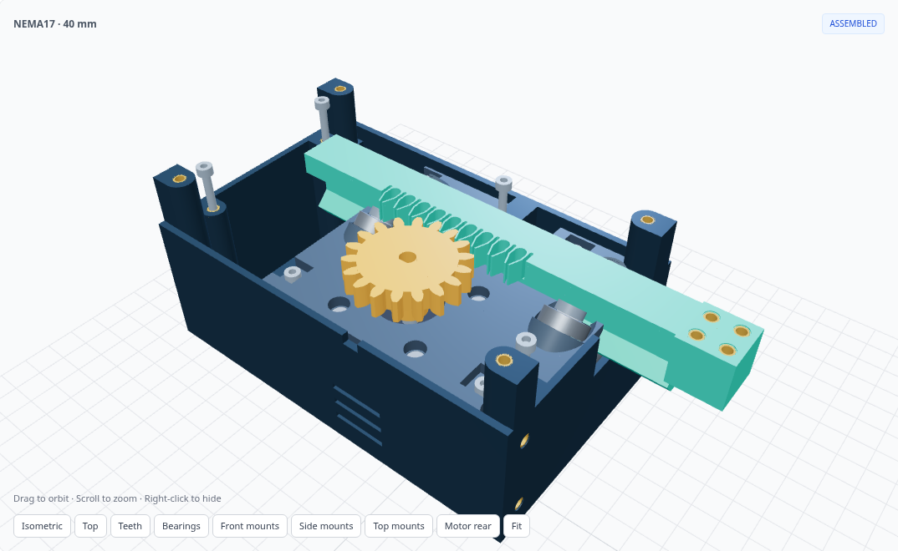](https://flex17-compliant-linear-actuator.seveibar.chatgpt.site/?motor=nema17&stroke=40&enclosure=enclosed)

### Compliant rack teeth

The rack teeth are oversized by **0.10 mm per flank** by default, so the flexible tooth walls preload the mesh. Circular reliefs blend tangentially into the slots, avoiding sharp internal corners where the teeth bend. There are no separate internal tooth fingers. The defaults use 0.60 mm walls and an 8 mm tooth face.

The design is intended to reduce backlash through elastic contact. It does not establish a measured backlash, force or fatigue rating. Tooth size is configurable through `--tooth-module`.

[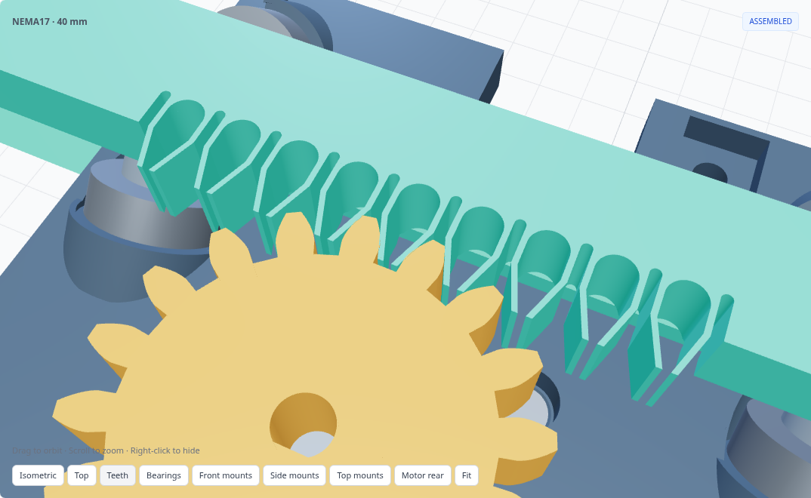](https://flex17-compliant-linear-actuator.seveibar.chatgpt.site/?motor=nema17&stroke=40&enclosure=enclosed)

[Inspect the teeth in 3D](https://flex17-compliant-linear-actuator.seveibar.chatgpt.site/?motor=nema17&stroke=40&enclosure=enclosed) using the **Teeth** view. The tooth concept is inspired by [seveibar/compliant-spur-gear](https://github.com/seveibar/compliant-spur-gear).

### Bearing guidance and integral flexures

All six guide bearings are **625ZZ, 5 × 16 × 5 mm**. Four upper bearings sit at 45°; two lower bearings press upward from integral flexure floors. Recesses in the rack provide vertical support. The bearing layout constrains the rack while allowing translation along its travel axis.

The lower flexure is a single broad floor with a **14 mm free span**, **1.8 mm default thickness**, supported R1.2 wall blends and **2.3 mm nominal installed deflection**. The STL chassis is relaxed; the STEP assembly and viewer show the installed shape. CAD deformation is prescribed, not a calculated load/deflection curve.

[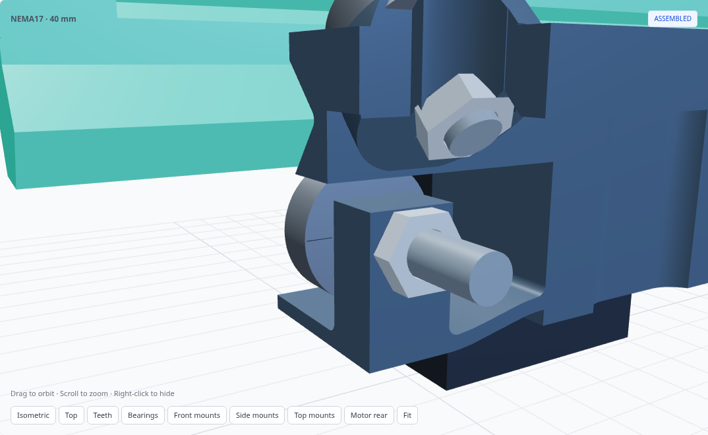](https://flex17-compliant-linear-actuator.seveibar.chatgpt.site/?motor=nema17&stroke=40&enclosure=enclosed)

The motor stays at X=0 and the rear bearing station at X=−32 mm. The exit station is **13 mm behind the front face**, placing the bearing rim 5 mm behind the opening. The pinion is offset toward the rear bearing group.

| Stroke | Bearing station centers X | Bearing span | Rack print length |
| --- | --- | --- | --- |
| 40 mm | −32, 44 mm | 76 mm | 161.5 mm |
| 100 mm | −32, 94 mm | 126 mm | 271.5 mm |
| 150 mm | −32, 144 mm | 176 mm | 371.5 mm |

Nominal rack/chassis clearance is 1 mm. Bearing relief defaults to 0.8 mm and axle-head relief to 0.5 mm. Check actual printed and purchased hardware clearances; clamp bearing inner races without clamping the rotating outer races.

## Mounting the module and its load

M3 heat-set inserts default to **4.6 mm OD × 5 mm long**, with **4.2 mm printed pilot holes**. Qualify the pilot and installation temperature for your particular inserts and print material. Four inserts are provided on each of the following mounting faces:

| Face | Mounting pattern | Insert position |
| --- | --- | --- |
| Front / rack exit (+X) | Housing width − 18 mm by motor depth − 10 mm | 0.3 mm recessed |
| Side (+Y) | Housing length − 15 mm by motor depth − 10 mm | 0.3 mm recessed |
| Top (+Z) | Housing length − 15 mm by housing width − 15 mm | Flush in full-height tray posts |
| Moving output (+Z) | 9 × 9 mm in an 18 × 18 mm pad | 0.3 mm recessed |

The output pad is centered on the rack backbone. Its four insert pockets continue as **3.4 mm through-holes through the full 18 mm pad**. Either fit M3 inserts or skip them and use M3 through-bolts with washers and nuts. Choose bolt length for the pad, attachment, washers and nut engagement. Use application-length screws with **3–5 mm insert engagement**: 3.3–5.3 mm penetration from recessed faces, or 3–5 mm from the flush top face. Use the selected preset's STEP file and mounting metadata to lay out your fixture.

[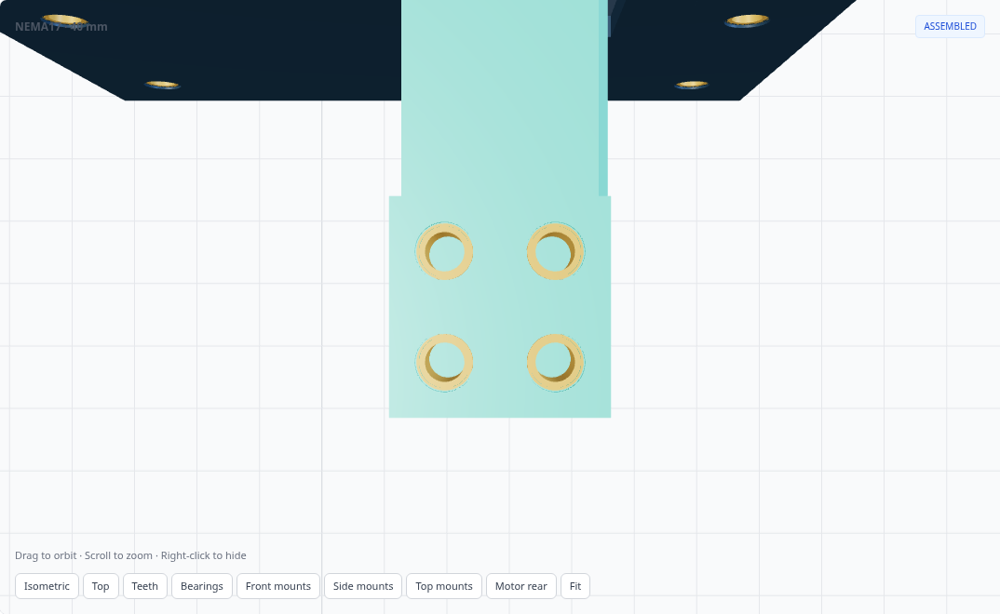](https://flex17-compliant-linear-actuator.seveibar.chatgpt.site/?motor=nema17&stroke=40&enclosure=enclosed)

[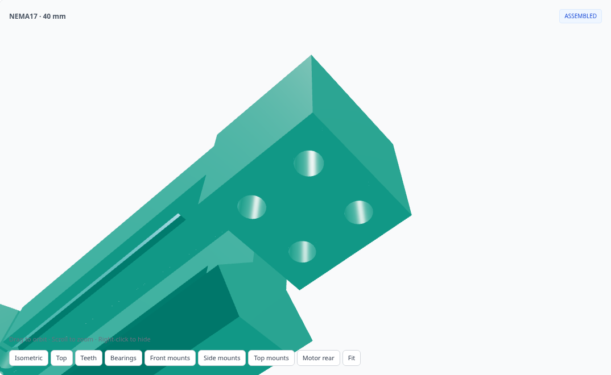](https://flex17-compliant-linear-actuator.seveibar.chatgpt.site/?motor=nema17&stroke=40&enclosure=enclosed)

The fixed front face has four inserts outside the rack opening. A front fixture must clear the moving guide and the entire output pad at full retraction. At module 2, the minimum rectangular fixture opening spans **Y=18.5…41 mm, Z=−10…22 mm**. Top fixtures load the full-height tray posts; remove them before opening the lid.

[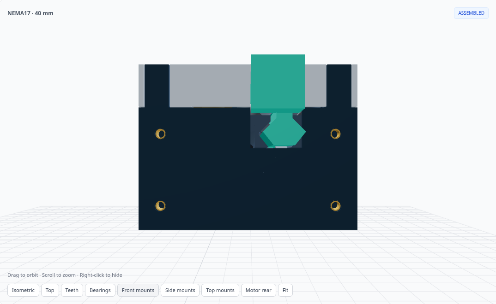](https://flex17-compliant-linear-actuator.seveibar.chatgpt.site/?motor=nema17&stroke=40&enclosure=enclosed)

[Open the mounting views](https://flex17-compliant-linear-actuator.seveibar.chatgpt.site/?motor=nema17&stroke=40&enclosure=enclosed) and select **Front mounts**, **Side mounts** or **Top mounts**.

### Motor and driver access

The motor mounting land is integral to the chassis. The pinion has a **5.30 mm D bore** for a nominal 5 mm shaft with a 0.5 mm-deep flat. Its M3×4 flat-point set screw acts normal to the shaft flat; tap the 2.5 mm pilot M3.

The motor rear projects 4 mm beyond the housing. Leave room behind it for the driver, wiring, cooling and removal. The screenshot shows the reference motor, not a modeled controller board.

[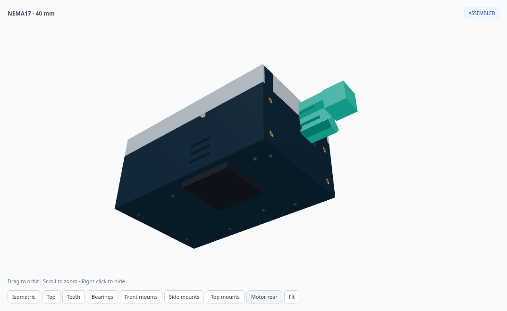](https://flex17-compliant-linear-actuator.seveibar.chatgpt.site/?motor=nema17&stroke=40&enclosure=enclosed)

## Hardware and printing

Every download bundle contains a preset-specific `bill-of-materials.json` and `configuration.json`.

| Common hardware | Quantity / specification |
| --- | --- |
| Stepper motor | 1 × matching NEMA17 or NEMA14 motor |
| Guide bearings | 6 × 625ZZ, 5 × 16 × 5 mm |
| Upper bearing axles | 4 × M5×16 socket screws |
| Lower bearing axles | 2 × M5×25 socket screws |
| Bearing nuts | 6 × thin M5 nuts, modeled 2.7 mm thick |
| Inner-race washers | 6 × 0.3 mm thick, 7.5 mm OD |
| Motor screws | 4 × M3×12 countersunk |
| Pinion set screw | 1 × M3×4 flat point |
| Lid screws | M3×20 socket; quantity below |
| Chassis screws | Front M3×10 / rear M3×16 socket; quantities below |
| External mounting screws | Application-specific lengths; observe insert engagement |

| Stroke / enclosure | Total M3 inserts, including output | Lid screws | Front / rear chassis screws |
| --- | --- | --- | --- |
| 40 mm, either enclosure | 24 | 4 | 2 / 2 |
| 100 mm, enclosed | 28 | 6 | 3 / 3 |
| 100 mm, pass-through | 26 | 4 | 3 / 3 |
| 150 mm, either enclosure | 28 | 6 | 3 / 3 |

Rear chassis inserts sit **6 mm below the standoff tops**, clearing the neighboring M5 hardware. Use the specified M3×16 rear screws; the front screws are M3×10.

| Printed part | Orientation / important detail |
| --- | --- |
| Chassis | Y normal to the bed, keeping the XZ flexure bending plane within the layers; use local supports at passages where needed |
| Rack | Tooth face down; output pad rests on the same plane; keep relief slots clear |
| Pinion | Gear face down; finish the set-screw pilot with an M3 tap |
| Tray | Outer floor down |
| Lid | Roof down |

Parts are single-piece. Check your printer's build volume, especially the 271.5 and 371.5 mm racks. A shorter enclosure does not shorten the printed rack. See [printing and assembly instructions](README.txt) for insert depths, clearances and the detailed assembly sequence.

## Assembly and service

[Open the assembly viewer](https://flex17-compliant-linear-actuator.seveibar.chatgpt.site/?motor=nema17&stroke=40&enclosure=enclosed) and select **Explode**. The slider separates components in stages, including lifting and parking axle hardware and moving the chassis before lowering the tray.

[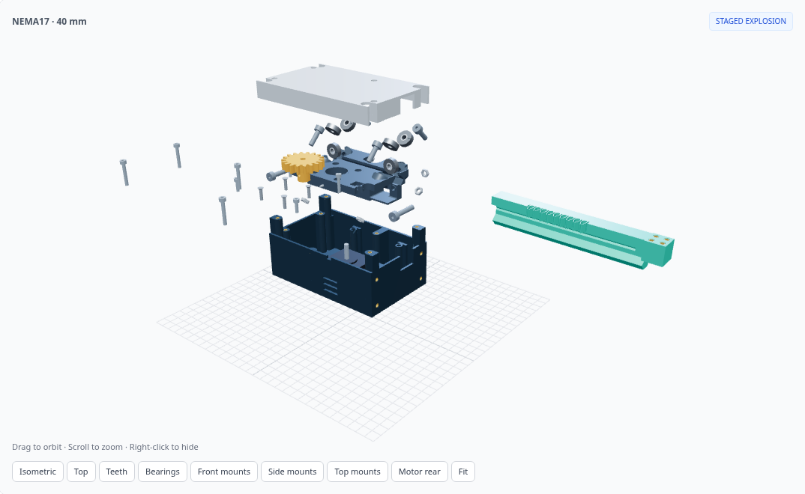](https://flex17-compliant-linear-actuator.seveibar.chatgpt.site/?motor=nema17&stroke=40&enclosure=enclosed)

A practical assembly outline:

1. Print and clean the five parts. Clear tooth reliefs and bearing pockets; prepare the pinion's set-screw thread.
2. Install the tray heat-set inserts and, if using them, the output-pad inserts before closing access to their pockets.
3. Fit the lower bearings with their axles backed out 10 mm and nuts held loose. Start the chassis 6 mm above and 10 mm behind its seated position, slide it forward, lower it, then advance the axles and tighten the nuts.
4. Install the front and rear chassis screws. Fit the motor and motor screws before the upper rollers and axles.
5. Fit the pinion and set screw. Insert the rack from the output side, square end first, with the motor free to turn; support the spring seats as needed.
6. Confirm all six bearings turn without rubbing, fit the lid, then attach the external fixture and load. Check full travel at low speed before applying load.

For service, remove external fixtures and load first. Follow the exploded sequence: lid and rack, pinion, upper axle hardware and rollers, motor, chassis screws, partial lower-axle withdrawal, chassis lift/slide, tray, then the remaining bearing hardware. The animation illustrates clearance paths; it does not model gravity or workholding. [README.txt](README.txt) gives the complete sequence.

## Resolution

For a 1.8° motor with 200 full steps per revolution:

```text
travel per command = π × tooth module × pinion tooth count / (200 × microstep factor)
```

| Setting | NEMA17, 18T: mm/command | NEMA14, 14T: mm/command |
| --- | --- | --- |
| Full step | 0.565487 | 0.439823 |
| Half step | 0.282743 | 0.219911 |
| 1/4 step | 0.141372 | 0.109956 |
| 1/8 step | 0.070686 | 0.054978 |
| 1/16 step | 0.035343 | 0.027489 |

These are nominal command increments, not measured positioning accuracy. Stroke and enclosure choice do not change the drive ratio. Match the calculation to the actual motor's full-step angle.

[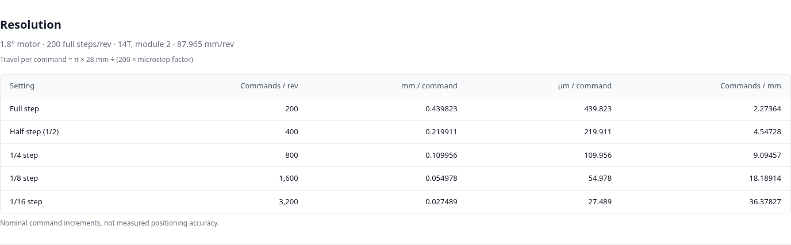](https://flex17-compliant-linear-actuator.seveibar.chatgpt.site/?motor=nema14&stroke=40&enclosure=pass-through#resolution)

[View the NEMA17 resolution table](https://flex17-compliant-linear-actuator.seveibar.chatgpt.site/?motor=nema17&stroke=40&enclosure=enclosed#resolution) · [View the NEMA14 resolution table](https://flex17-compliant-linear-actuator.seveibar.chatgpt.site/?motor=nema14&stroke=40&enclosure=enclosed#resolution)

## Download and customize

The easiest route is to [open the site](https://flex17-compliant-linear-actuator.seveibar.chatgpt.site/), choose **Motor**, **Variant** and **Stroke preset**, then use **Downloads → CAD bundle**. Each bundle includes:

- Five printable STL parts and a STEP assembly.
- Parametric CadQuery source and the selected configuration.
- Hardware quantities, printing/assembly instructions and licenses.
- Collision, guide and service-clearance reports.

The **Configure** panel exports JSON parameters or a CadQuery command. Tooth module, stroke, housing length and motor body depth are separate parameters. The viewer displays generated module-2 presets; custom values require regeneration.

[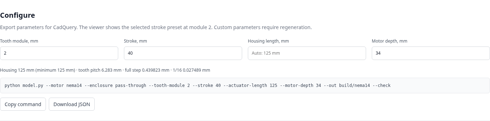](https://flex17-compliant-linear-actuator.seveibar.chatgpt.site/?motor=nema14&stroke=40&enclosure=pass-through#configure)

[Open the configurator](https://flex17-compliant-linear-actuator.seveibar.chatgpt.site/?motor=nema17&stroke=40&enclosure=enclosed#configure) · [NEMA17 downloads](https://flex17-compliant-linear-actuator.seveibar.chatgpt.site/?motor=nema17&stroke=40&enclosure=enclosed#files) · [NEMA14 downloads](https://flex17-compliant-linear-actuator.seveibar.chatgpt.site/?motor=nema14&stroke=40&enclosure=enclosed#files)

### Run the viewer locally

The generated models are committed, so previewing them does not require CadQuery:

```sh
git clone https://github.com/tscircuit/rack-actuator.git
cd rack-actuator
python -m http.server 8000 --directory dist
```

Open `http://localhost:8000`. Use an HTTP server rather than opening `index.html` directly, because the viewer loads model files with `fetch`.

### Generate a custom actuator

Use Python 3.12 and CadQuery 2.7.0:

```sh
pip install -r requirements.txt

# Example: NEMA14, 100 mm stroke, shorter rear pass-through housing
python model.py --motor nema14 --stroke 100 --enclosure pass-through --out build/custom --check

# Or use the configuration exported by the site / included in a bundle
python model.py --config path/to/configuration.json --out build/custom --check
```

Explicit CLI arguments override JSON values. Housing length defaults to the calculated minimum for the selected stroke, tooth size and enclosure. The CLI name for housing length is `--actuator-length`.

| Parameter | Supported values / default |
| --- | --- |
| `--motor` | `nema17` (default) or `nema14` |
| `--enclosure` | `enclosed` (default) or `pass-through` |
| `--stroke` | 20–150 mm; default 40 |
| `--tooth-module` | 1.5–2.5 mm; default 2 |
| `--actuator-length` | Calculated minimum through 2000 mm |
| `--motor-depth` | 32–60 mm; defaults 40 / 34 for NEMA17 / NEMA14 |
| `--insert-od`, `--insert-length`, `--insert-pilot` | Defaults 4.6 / 5 / 4.2 mm |
| `--spring-preload` | 0.1–2.5 mm; default 2.3 |
| `--spring-thickness` | 1.6–2.2 mm; default 1.8 |
| `--bearing-clearance`, `--hardware-clearance` | Defaults 0.8 / 0.5 mm |
| `--rack-backbone-width` | 14.5–18 mm; default 16 |
| `--preload` | Tooth oversize per flank; default 0.10 mm |

Regenerate, check and package all twelve presets from the repository root:

```sh
python build_presets.py --jobs 4
python check_flexure_service.py --jobs 4
python check_lid_screw_parking.py --all
python package_designs.py
```

The output through-hole update was checked as an exact material-removal change against the previously validated rack on all twelve presets. Each report records its prior full-check source hash and new hole/insert checks; unchanged motion and service-path results are retained. The worm experiment was also rechecked through motion and cartridge separation.

Build caching is tied to source, motor, stroke and enclosure. Use a distinct output directory for custom models to keep the supplied presets intact.

## Validation and practical limits

The supplied presets have completed sampled travel, explosion and service checks with no unexpected intersections. The reports distinguish intentional elastic tooth contact and heat-set insert interference from unwanted solid intersections.

| Report / check | What it covers |
| --- | --- |
| `validation.json` | Assembled part pairs; 41 travel positions; guide contacts; nominal tooth mesh; insert access, annular backing and output through-holes; flexure/hardware clearances; staged explosion |
| `flexure-service-validation.json` | Bearing and enclosure service paths from 38–100% explosion, with translation increments at most 0.5 mm |
| `lid-screw-clearance.json` | Continuous swept envelopes for removing lid screws and separating them from subsequent assembly motion |
| `check_guide_constraints.py` | Bearing guidance constraints |

Enclosure/fastener paths are sampled at no more than 0.5 mm translation increments. Core explosion checks include 1% slider intervals, stage boundaries/midpoints and bearing-release transitions. Reports record source hashes and explain any retained results where geometry and checking logic are unchanged.

These checks do not replace a physical tolerance, side-load or fatigue test. The flexure's restoring force, recovery and lifetime have not been rated; the compliant teeth have no measured backlash/load rating. There is no axial hard stop or downward flexure stop. Use controller travel limits and validate the print material and actual hardware before loading the module.

[Open validation reports on the site](https://flex17-compliant-linear-actuator.seveibar.chatgpt.site/?motor=nema17&stroke=40&enclosure=enclosed#assembly) · [Detailed assembly instructions](README.txt)

## Repository map

| Path | Contents |
| --- | --- |
| [model.py](model.py) | Parametric CadQuery geometry, exports and checks |
| [build_presets.py](build_presets.py) | Generates the two motors × three strokes × two enclosures |
| [package_designs.py](package_designs.py) | Packages downloads and creates the preset manifest |
| [check_flexure_service.py](check_flexure_service.py) | Dense bearing-removal/service checks |
| [check_lid_screw_parking.py](check_lid_screw_parking.py) | Lid-screw clearance proof |
| [dist/](dist/) | Static viewer, generated meshes and CAD downloads |
| [dist/presets.json](dist/presets.json) | Paths and metadata for all twelve presets |
| [README.txt](README.txt) | Detailed printing, insert installation and assembly instructions |
| [docs/images/](docs/images/) | Screenshots of the revision 24 viewer and mechanism |

## License and credits

MIT; see [LICENSE](LICENSE). The compliant tooth principle is inspired by [seveibar/compliant-spur-gear](https://github.com/seveibar/compliant-spur-gear). Its license is included in the CAD bundles.
