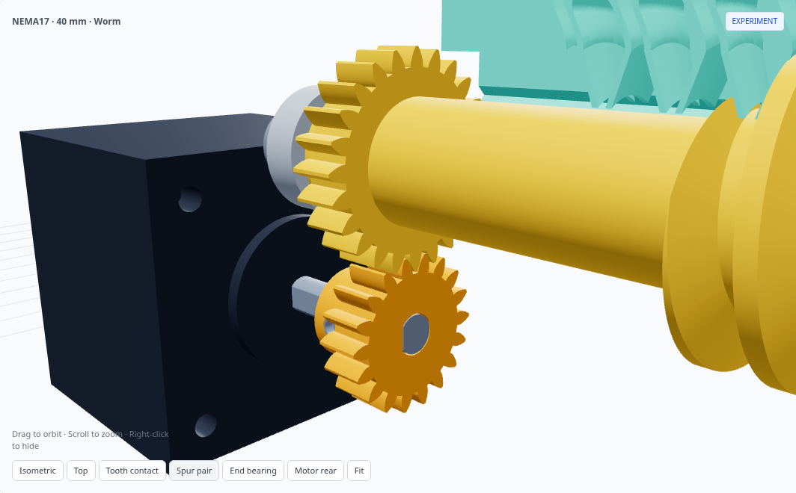

# Spur-driven worm actuator

**[Open the worm viewer](https://flex17-compliant-linear-actuator.seveibar.chatgpt.site/experiments/worm-rack/)** · [Standard spur actuator](https://flex17-compliant-linear-actuator.seveibar.chatgpt.site/)

NEMA17 and NEMA14 presets at **40, 100 and 150 mm stroke** use the **same enclosure length, width, height, external mounting-hole coordinates and mounting planes** as their matching fully enclosed rack-and-pinion models. The lid is flat. The motor sits lower and projects through the rear aperture; leave room behind its exposed back face for the controller. The pass-through spur variant uses a different enclosure reference.

[](https://flex17-compliant-linear-actuator.seveibar.chatgpt.site/experiments/worm-rack/)

The motor's printed D-bore pinion drives an **integral 24T spur gear on the worm**. Both worm ends contain an **M5 heat-set insert**, with an **M5×16 bolt through a 625ZZ bearing** in the integral chassis. There is no separate coupling, motor cartridge or bearing keeper. The motor and its pinion install and withdraw as a subassembly.

The worm contacts the **underside of a matched compliant rack**. The rack retains its six-bearing guide profile and four-hole output mount. A broad upper spine joins the downward-facing teeth to the guide. The smooth tooth reliefs, module 2 axial profile and 0.10 mm oversize per flank remain; this rack is specific to the worm drive.

[](https://flex17-compliant-linear-actuator.seveibar.chatgpt.site/experiments/worm-rack/)

## Drive and resolution

| Parameter | NEMA17 | NEMA14 |
| --- | ---: | ---: |
| Motor body default | 42 × 42 × 40 mm | 35.2 × 35.2 × 34 mm |
| Motor / worm spur teeth | 18 / 24 | 14 / 24 |
| Spur module / pressure angle | 1 mm / 25° | 1 mm / 25° |
| Spur center distance | 21 mm | 19 mm |
| Worm pitch / outside diameter | 22 / 26 mm | 22 / 26 mm |
| Worm axial module / pressure angle | 2 mm / 20° | 2 mm / 25° |
| Worm lead, single start | 6.283185 mm/rev | 6.283185 mm/rev |
| Travel per motor revolution | 4.712389 mm | 3.665191 mm |
| Motor center height, assembly Z | −20 mm | −18 mm |

For a 1.8° motor with 200 full steps per revolution:

| Setting | NEMA17 µm / command | NEMA14 µm / command |
| --- | ---: | ---: |
| Full step | 23.562 | 18.326 |
| Half step | 11.781 | 9.163 |
| 1/4 step | 5.890 | 4.581 |
| 1/8 step | 2.945 | 2.291 |
| 1/16 step | 1.473 | 1.145 |

These are command increments, not measured accuracy or repeatability. The added spur pair has print clearance and can introduce backlash; it is not an anti-backlash gear pair. The worm's sliding contact, printed shaft stiffness, drive force, wear, heating and ability to load the compliant teeth still need physical testing. Do not assume self-locking.

## Enclosure and mounting

| Stroke | NEMA17 shell (L × W × H) | NEMA14 shell (L × W × H) |
| --- | --- | --- |
| 40 mm | 146 × 90.8 × 68.9 mm | 146 × 84.8 × 62.9 mm |
| 100 mm | 256 × 90.8 × 68.9 mm | 256 × 84.8 × 62.9 mm |
| 150 mm | 356 × 90.8 × 68.9 mm | 356 × 84.8 × 62.9 mm |

These dimensions exclude the protruding motor, controller and moving output. Select the motor and stroke in the viewer. Each download includes `configuration.json`, `mounting.json`, a bill of materials and its own validation report. The mounting reference is the corresponding **fully enclosed spur preset**, including its top, side, front-face and output interfaces.

The motor extends farther through the rear than in the previous raised-cover worm version, making room for the spur gears and both bearing supports inside the standard shell. The viewer reports this projection separately from enclosure dimensions. Rear-mounted controller dimensions are deliberately not modeled. Small front and rear service openings provide axial bearing and bolt access. The four front-face M3 mounts retain their positions.

Internal lid fasteners and supporting webs are adjusted for the lower motor and wider rack spine. The top mounting inserts stay at their original height; no raised hood or top mounting-plate cutout is required.

[](https://flex17-compliant-linear-actuator.seveibar.chatgpt.site/experiments/worm-rack/)

## Hardware

There are **six printed assembly parts**: chassis, rack, worm with integral spur gear, motor pinion, enclosure tray and flat cover. A tooth-fit coupon is also supplied.

- **Eight 625ZZ bearings**, 5 × 16 × 5 mm: six rack guides and two worm supports.
- **Two M5 inserts**, Ø7 × 8 mm, in Ø6.6 mm axial pilots, recessed 0.3 mm into the worm ends. Match these dimensions to the inserts you buy.
- **Two M5×16 socket-head bolts**, each with 8 mm insert engagement and 0.6 mm blind-pilot tip clearance.
- At each worm end: **2 mm metal inner-race spacer** and **0.3 mm washer**, both Ø7.5 outside / Ø5.3 inside. The spacers and washers contact the inner races.
- One **M3×4 flat-point set screw** in the motor pinion. Tap its printed Ø2.5 mm radial pilot M3. The Ø5.30 mm D bore accepts the reference Ø5 mm shaft with a 0.5 mm flat; the screw faces that flat.
- Four M3×10 motor screws; check engagement with your actual motor.
- Two M3×10 rear chassis-support screws and M3 inserts, Ø4.6 × 5 mm.
- The existing guide axle hardware, enclosure inserts and chassis/lid screws are listed in the preset BOM.
- Four optional M3 output inserts; the Ø3.4 mm holes pass through the entire output pad, so through-bolts, washers and nuts are also possible.

Opposing shoulders locate the end bearings axially. Their Ø12 mm central openings clear the rotating inner races; the outer 2 mm of each bearing face remains supported. The narrow upper openings clear the rack teeth while retaining the bearings radially; the bearings install along X. The inner-race bolt stacks hold the two bearings to the worm without separate keepers. Snug the bolts without forcing bearing preload and check end play and free rotation on the print.

[](https://flex17-compliant-linear-actuator.seveibar.chatgpt.site/experiments/worm-rack/)

## Assembly

1. Install the chassis/enclosure inserts and both worm M5 inserts. Tap the pinion's M3 set-screw pilot.
2. Assemble the six rack-guide bearings and axle hardware on the unloaded chassis outside the enclosure. Install the guide subassembly into the tray using the separately checked service path: retract lower axles 8 mm, enter 2.5 mm rearward and 6 mm above the seats, slide forward, lower, and seat the axles. Fit the chassis screws before inserting the rack.
3. Fit the pinion on the motor shaft with its flat aligned to the set screw. Set the axial position to the CAD dimensions and secure it while outside the enclosure.
4. Place the worm in its lowered service position. Slide the rack in from the output side, then raise and phase the worm into the compliant teeth.
5. Fit the two 2 mm spacers, slide both end bearings inward, and fit the washers and M5 bolts. Verify free rotation and end play.
6. Insert the motor-and-pinion subassembly through the rear aperture, phase the spur teeth, and tighten the four motor screws. Check the entire stroke by hand before fitting the flat cover.

The **Explode drive** slider follows the reverse sequence. The motor mounting screws back out enough to release the motor and remain in the chassis. Both bearing bolts, bearings and spacers withdraw axially. The worm lowers 7 mm to release the rack, the rack slides out, and the worm then lifts clear. The final insert motions show installation paths; removing installed heat-set inserts requires heat. The viewer uses sampled CAD shapes to show the guide floors relaxing as the rack leaves.

[](https://flex17-compliant-linear-actuator.seveibar.chatgpt.site/experiments/worm-rack/)

## Printing and validation

The chassis STL has unloaded flexure floors. The rack and flat cover are oriented with their broad top faces on the print bed. The worm is vertical; inspect support requirements for its integral spur wheel and helical flanks. Also check bridges and supports at the chassis motor aperture and enclosure rear opening. The motor pinion is a separate printed part. Use the coupon to check tooth fit before printing the complete rack. Long presets require an appropriately sized printer.

ZIP bundles contain ordinary STEP and STL files plus source, configuration, BOM and validation. Standalone STEP/STL files are gzip-compressed in [`downloads/worm`](https://github.com/tscircuit/rack-actuator/tree/main/downloads/worm). The viewer links directly to the matching STEP file; complete ZIP bundles remain on the site. The production spur geometry is unchanged.

Checks cover valid single solids, all assembled solid pairs, both insert fits, spur and worm kinematics, full-stroke travel, mounting-plane and enclosure-bound equality, tool access, guide assembly, chassis insertion and staged drive disassembly. FCL screens fine CAD tessellations and OCC measures candidate solid intersections. Intentional insert interference and compliant tooth preload are reported separately. The final inner-race relief and the short-preset mounting clearances are certified as chassis-only material removal against the completed full checks. Each report retains the full-check source hash and exact solid-difference results for all nine flexure states; the reference source and report are included in the ZIP. Collision-free paths remain valid when only stationary chassis material is removed. These are sampled geometric checks, not continuous-motion proof, elastic simulation or physical testing.

```sh
pip install -r experiments/worm-rack/requirements.txt
python experiments/worm-rack/model.py --motor nema17 --stroke 40 --check
python experiments/worm-rack/build_presets.py --jobs 2 --skip-valid
python -m http.server 8000 --directory dist
```

Open `http://localhost:8000/experiments/worm-rack/`. All experimental geometry remains separate from the standard spur models.
