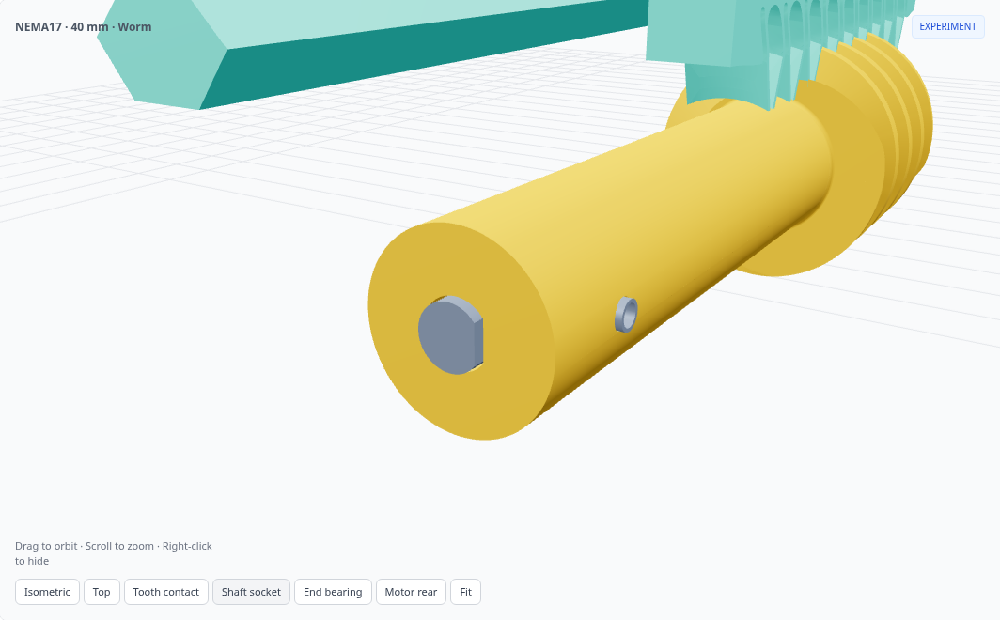
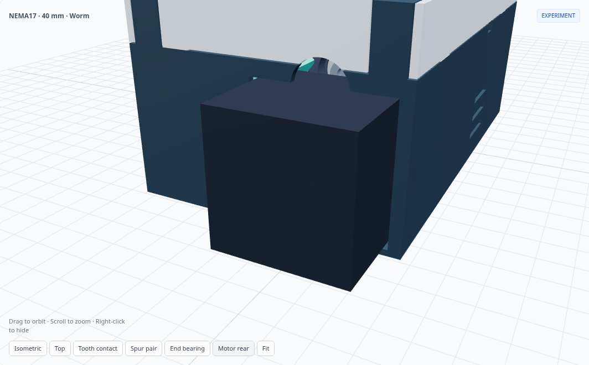

# Direct-shaft worm actuator

**[Open the worm viewer](https://flex17-compliant-linear-actuator.seveibar.chatgpt.site/experiments/worm-rack/)** · [Standard spur actuator](https://flex17-compliant-linear-actuator.seveibar.chatgpt.site/)

NEMA17 and NEMA14 presets at **40, 100 and 150 mm stroke** retain the enclosure dimensions, external mounting-hole coordinates and mounting planes of their matching fully enclosed spur models. The motor stays at the previous geared prototype’s position, with its back exposed for the controller.

[](https://flex17-compliant-linear-actuator.seveibar.chatgpt.site/experiments/worm-rack/)

The one-piece worm fits directly onto the motor D shaft. Both spur gears and the rear worm bearing are removed. The matched compliant tooth strip moves down **21 mm for NEMA17 / 19 mm for NEMA14**, joined to the original guide backbone by a deep web and triangular rib. The six guide bearings and four-hole output mount retain their positions. Smooth tooth reliefs and 0.10 mm oversize per flank remain.

[](https://flex17-compliant-linear-actuator.seveibar.chatgpt.site/experiments/worm-rack/)

[](https://flex17-compliant-linear-actuator.seveibar.chatgpt.site/experiments/worm-rack/)

## Drive and resolution

| Parameter | NEMA17 | NEMA14 |
| --- | ---: | ---: |
| Motor body default | 42 × 42 × 40 mm | 35.2 × 35.2 × 34 mm |
| Motor / worm speed ratio | 1:1 | 1:1 |
| Worm pitch / outside diameter | 22 / 26 mm | 22 / 26 mm |
| Worm axial module / pressure angle | 2 mm / 20° | 2 mm / 25° |
| Single-start lead | 6.283185 mm/rev | 6.283185 mm/rev |
| Motor and worm center Z | −20 mm | −18 mm |

For either 1.8° motor, with 200 full steps per revolution:

| Setting | mm / command | µm / command |
| --- | ---: | ---: |
| Full step | 0.031416 | 31.416 |
| Half step | 0.015708 | 15.708 |
| 1/4 step | 0.007854 | 7.854 |
| 1/8 step | 0.003927 | 3.927 |
| 1/16 step | 0.001963 | 1.963 |

These are command increments, not measured accuracy. Removing the reduction increases travel per motor revolution and removes its extra gear backlash. Drive force, axial stiffness, motor bearing loading, wear and heat still require physical testing. Do not assume self-locking.

## Enclosure and mounting

| Stroke | NEMA17 shell (L × W × H) | NEMA14 shell (L × W × H) |
| --- | --- | --- |
| 40 mm | 146 × 90.8 × 68.9 mm | 146 × 84.8 × 62.9 mm |
| 100 mm | 256 × 90.8 × 68.9 mm | 256 × 84.8 × 62.9 mm |
| 150 mm | 356 × 90.8 × 68.9 mm | 356 × 84.8 × 62.9 mm |

Dimensions exclude the protruding motor, controller and moving output. The reference is the **fully enclosed spur preset**, not the pass-through variant. The lid remains flat. The front aperture clears the lowered rack; an axial service port reaches the end bolt. External M3 mounts stay in place. Rear-mounted controller dimensions are not modeled.

[](https://flex17-compliant-linear-actuator.seveibar.chatgpt.site/experiments/worm-rack/)

## Hardware

**Five printed assembly parts:** chassis, rack, direct-shaft worm, enclosure tray and flat cover. A tooth-fit coupon is supplied separately.

- **Seven 625ZZ bearings**, 5 × 16 × 5 mm: six guides and one worm end support.
- **One M5 insert**, Ø7 × 8 mm, in a Ø6.6 mm axial pilot, installed flush with the worm end.
- **One M5×16 socket bolt**, with 8 mm insert engagement and 0.6 mm blind-pilot tip clearance.
- One **2 mm metal inner-race spacer** and one **0.3 mm washer**, both Ø7.5 outside / Ø5.3 inside.
- One **M3×6 flat-point set screw**. Tap the worm’s Ø2.5 mm radial pilot M3. The screw faces the flat of the Ø5.30 mm D socket; reference shaft diameter is 5 mm with a 0.5 mm flat. Verify your actual shaft length and flat.
- Four M3×10 motor screws; two recessed M3×8 rear chassis-support screws with Ø4.6 × 5 mm M3 inserts.
- Existing guide axle hardware, enclosure inserts and chassis/lid screws are listed in each BOM.
- Four optional M3 output inserts. Ø3.4 mm holes pass through the output pad for alternative through-bolts.

The end bearing’s outer race is captured between a chassis shoulder and a front stop integral to the enclosure tray. The nominal axial fit allowance is **0.3 mm**. The central openings clear the inner race; the bolt, washer and spacer clamp that race to the worm. The spacer seats directly against the flush metal insert face (16.42 mm² contact area), avoiding a thin printed seating lip. There are no keeper screws or additional printed parts. Check printed endplay, free rotation and your motor’s axial-load rating before applying load; this is not a zero-backlash thrust bearing arrangement.

[](https://flex17-compliant-linear-actuator.seveibar.chatgpt.site/experiments/worm-rack/)

## Assembly

1. Install enclosure/chassis inserts and the worm’s M5 insert. Tap the M3 set-screw pilot.
2. Insert the worm end bearing into the bare chassis from +X, outside the enclosure, then assemble the six guide bearings and their axle hardware. Install this subassembly into the tray using the checked service path; the tray stop then captures the end bearing. Secure chassis screws.
3. Align the worm D socket and motor shaft, position the worm face 2.8 mm ahead of the motor face, and tighten the set screw while outside the enclosure.
4. Insert motor and worm together through the rear. Tighten the four motor screws.
5. Lower the 2 mm inner-race spacer through its chassis slot. Fit the end washer and M5 bolt through the front service port. Verify free rotation and endplay.
6. Insert the rack from the front, turning the worm to draw the teeth into engagement. Check the full stroke by hand before installing the cover.

The **Explode drive** slider reverses this sequence: remove the lid, turn the worm while winding the rack clear, slide the rack out, remove the end bolt/washer, lift the spacer, release motor screws, and withdraw motor and worm together. The bearing stays captured in the base. The final insert motion shows its installation path; removal of an installed heat-set insert requires heat. Guide floors relax through sampled CAD states as the rack leaves.

[](https://flex17-compliant-linear-actuator.seveibar.chatgpt.site/experiments/worm-rack/)

## Printing and validation

Chassis STL flexures are unloaded. The rack and cover are oriented top-face down; the rack rib tapers inward in that orientation. The worm prints vertically. Inspect helical flanks, motor aperture and rear opening in your slicer for support requirements. Print the tooth coupon first. Longer worms need care with straightness and torsional stiffness.

Each ZIP includes ordinary STEP/STLs, CadQuery source, configuration, mounting coordinates, BOM and a fresh validation report. Standalone compressed CAD files live in [`downloads/worm`](https://github.com/tscircuit/rack-actuator/tree/main/downloads/worm). Production spur geometry is unchanged.

Checks cover valid single solids, assembled solid pairs, insert fit, bearing capture, worm/rack engagement, full-stroke motion, enclosure and mounting equality, tool access, guide installation and staged drive separation. FCL screens fine CAD tessellations; OCC confirms candidate interference volumes. Insert interference and compliant tooth preload are intentional. Explosion translations are sampled at no more than 0.5 mm increments, with separate dense worm phase checks. These are sampled geometric checks, not continuous-motion proof, elastic simulation or physical testing.

Run these commands from a full repository checkout; validation compares against the published spur preset references.

```sh
pip install -r experiments/worm-rack/requirements.txt
python experiments/worm-rack/model.py --motor nema17 --stroke 40 --check
python experiments/worm-rack/build_presets.py --jobs 2 --skip-valid
python -m http.server 8000 --directory dist
```

Open `http://localhost:8000/experiments/worm-rack/`. This experiment remains separate from the standard spur models.
