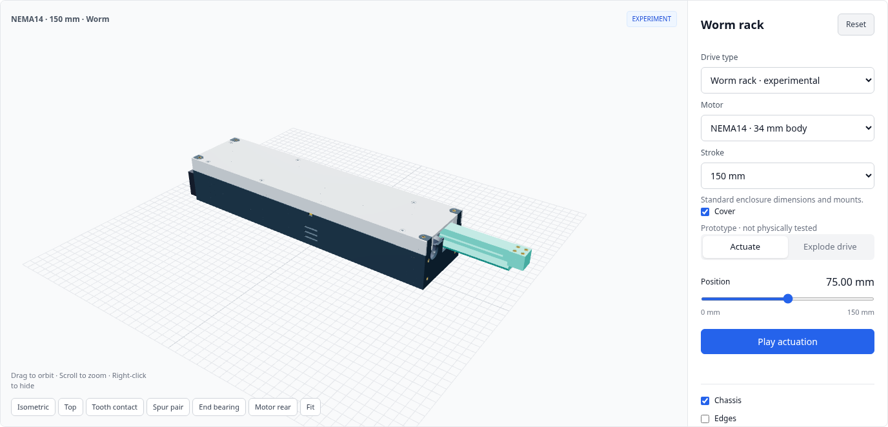
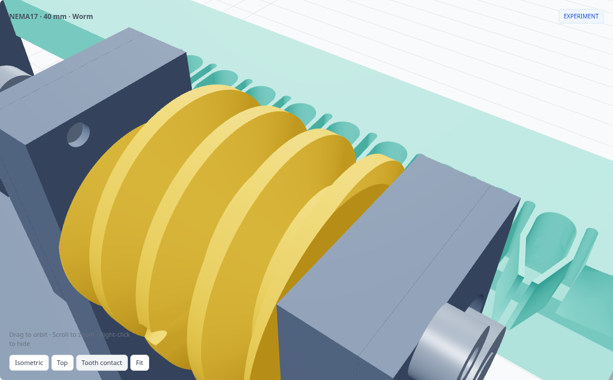
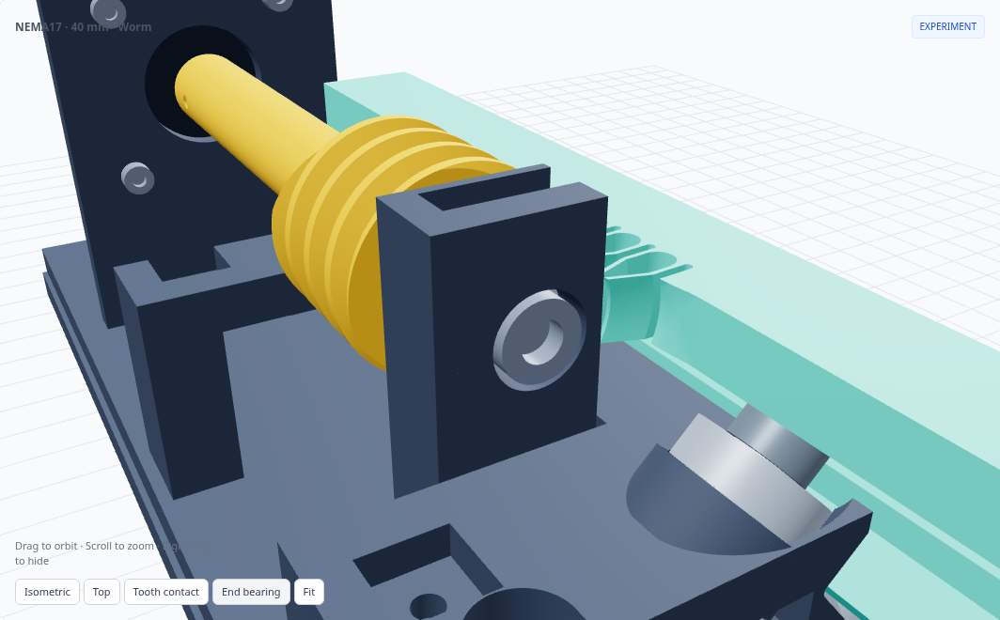
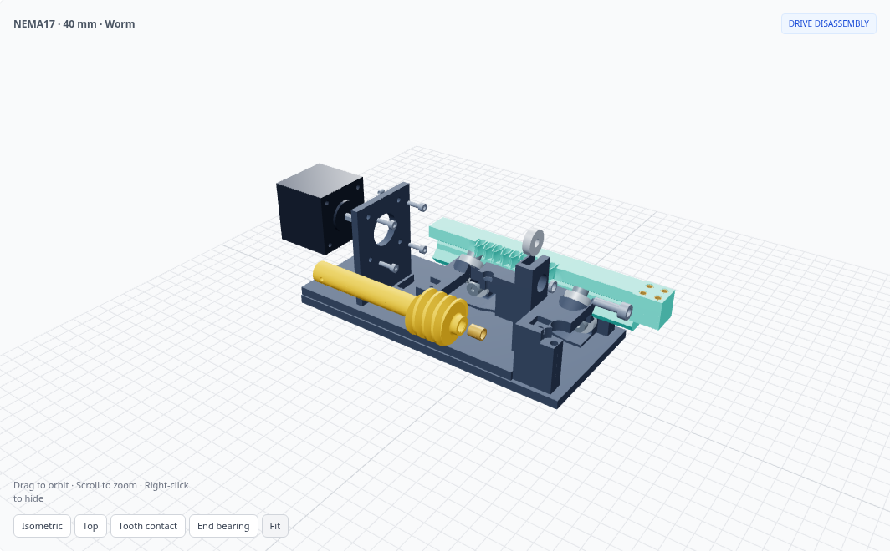

# Worm-to-compliant-rack experiment

**[Open the experimental viewer](https://flex17-compliant-linear-actuator.seveibar.chatgpt.site/experiments/worm-rack/)** · [Production spur actuator](https://flex17-compliant-linear-actuator.seveibar.chatgpt.site/?motor=nema17&stroke=40)

An enclosed **NEMA17 / NEMA14** worm-to-compliant-rack family, with **40, 100 and 150 mm stroke**. Select the motor and stroke in the [worm viewer](https://flex17-compliant-linear-actuator.seveibar.chatgpt.site/experiments/worm-rack/). The twelve production spur models retain their geometry.

Each worm model preserves the **top, side, front-face and output mounting-hole coordinates and face planes** of its matching **fully enclosed spur** model. The cover rises over the worm and motor, and the enclosure extends rearward. A solid flat top mounting plate needs a clearance cutout around the raised hood; matching holes alone do not guarantee clearance to surrounding equipment. The short pass-through spur housing is a different mounting reference.

The motor's **rear face projects 4 mm outside the rear aperture**. Its mounting surface remains exposed; rear-mounted controller dimensions are deliberately not modeled. Motor body defaults are 42 × 42 × 40 mm for NEMA17 and 35.2 × 35.2 × 34 mm for NEMA14.

| Motor | Stroke | Enclosure L × W × H | One-piece worm | Viewer |
| --- | ---: | --- | ---: | --- |
| NEMA17 | 40 mm | 188 × 90.8 × 87.6 mm | 103 mm | [Open](https://flex17-compliant-linear-actuator.seveibar.chatgpt.site/experiments/worm-rack/?motor=nema17&stroke=40) |
| NEMA17 | 100 mm | 298 × 90.8 × 87.6 mm | 163 mm | [Open](https://flex17-compliant-linear-actuator.seveibar.chatgpt.site/experiments/worm-rack/?motor=nema17&stroke=100) |
| NEMA17 | 150 mm | 398 × 90.8 × 87.6 mm | 213 mm | [Open](https://flex17-compliant-linear-actuator.seveibar.chatgpt.site/experiments/worm-rack/?motor=nema17&stroke=150) |
| NEMA14 | 40 mm | 182 × 84.8 × 78.2 mm | 103 mm | [Open](https://flex17-compliant-linear-actuator.seveibar.chatgpt.site/experiments/worm-rack/?motor=nema14&stroke=40) |
| NEMA14 | 100 mm | 292 × 84.8 × 78.2 mm | 163 mm | [Open](https://flex17-compliant-linear-actuator.seveibar.chatgpt.site/experiments/worm-rack/?motor=nema14&stroke=100) |
| NEMA14 | 150 mm | 392 × 84.8 × 78.2 mm | 213 mm | [Open](https://flex17-compliant-linear-actuator.seveibar.chatgpt.site/experiments/worm-rack/?motor=nema14&stroke=150) |

[](https://flex17-compliant-linear-actuator.seveibar.chatgpt.site/experiments/worm-rack/?motor=nema14&stroke=150)

There are **five printed assembly parts**: chassis, rack, one-piece worm, enclosure tray and removable cover. The worm's integral stem plugs directly onto the motor's D shaft. At the opposite end, an **axial M5 heat-set insert accepts an M5×16 bolt through a 625ZZ bearing**. The top-loading bearing saddle and motor bracket are part of the chassis. There is no separate coupling, drive shaft, motor cartridge, bearing keeper, keeper screw or shaft collar.

The active helix remains 24 mm long near the rack. The smooth stem is longer for longer strokes and thickens to improve torsional stiffness: NEMA17 uses Ø13 / 15 / 16 mm for 40 / 100 / 150 mm; NEMA14 uses Ø12 / 13 / 13 mm. Printed-stem stiffness and usable load have not been physically measured.

[](https://flex17-compliant-linear-actuator.seveibar.chatgpt.site/experiments/worm-rack/)

## Tooth geometry

| Parameter | Value |
| --- | --- |
| Axial module / pitch | 2 mm / 6.283185 mm |
| Center-section pressure angle | 20° NEMA17 / 25° NEMA14 |
| Worm starts / lead | 1 / 6.283185 mm per revolution |
| Worm pitch / outside diameter | NEMA17: 24 / 28 mm; NEMA14: 22 / 26 mm |
| One-piece worm length / active helix | 103, 163 or 213 / 24 mm |
| Motor D-shaft engagement | 16 mm |
| Axial M5 insert / pilot | Ø7 × 8 mm / Ø6.6 mm |
| Insert recess / bolt tip clearance | 0.3 / 0.6 mm |
| End bearing seat | Ø16.3 × 5.3 mm, open at the top |
| Rack tooth face | 8 mm |
| Rack oversize | 0.10 mm per flank |
| Worm flank allowance | 0.03 mm per flank |
| Nominal net elastic engagement | 0.07 mm per flank, before printing tolerances |
| Shaft / printed D bore | 5 / 5.30 mm |

The original straight rack cannot simply be reused: its profile does not follow the worm through the tooth thickness. The experiment preserves the **module, motor-specific axial tooth profile and smooth compliant reliefs at the center plane**, then curves the tooth flanks to match the worm. It retains the lower six-bearing guide rail and original output mount, including its four M3 insert pockets with 3.4 mm clearance holes through the full 18 mm pad. The output inserts are optional: M3 through-bolts, washers and nuts can be used instead.

For a point `(x, y)` in the original rack profile, and worm axis `(Y, Z) = (6, 17)` mm for NEMA17 or `(7, 17)` mm for NEMA14:

```text
r = y − Y
θ = asin((z − Z) / r)
x′ = x + lead / (2π) × θ
y′ = Y + sqrt(r² − (z − Z)²)
```

The mapping is blended back into the rigid backbone above the tooth roots and into the plain rack beyond the tooth field. CAD splines approximate this surface; collision checks evaluate the resulting solids/meshes, not just the formula. Positive rack travel requires negative rotation about the worm's +X axis.

## Resolution

For a 1.8° motor with 200 full steps per revolution:

| Setting | mm per command | µm per command |
| --- | ---: | ---: |
| Full step | 0.031416 | 31.416 |
| Half step | 0.015708 | 15.708 |
| 1/4 step | 0.007854 | 7.854 |
| 1/8 step | 0.003927 | 3.927 |
| 1/16 step | 0.001963 | 1.963 |

These are **command increments**, 18× finer than the NEMA17 18T spur version and 14× finer than the NEMA14 14T version. Both worm sizes use the same lead and command increment. They do not establish positioning accuracy, repeatability, holding force or self-locking. A worm introduces substantial sliding contact; heating, friction, wear and the ability to drive the preloaded teeth are open questions.

[](https://flex17-compliant-linear-actuator.seveibar.chatgpt.site/experiments/worm-rack/)

## Hardware and assembly

Retain the six 625ZZ rack guide bearings and their M5 axle hardware. The revised drive uses:

- One 625ZZ end bearing, 5 × 16 × 5 mm: **seven bearings total**.
- One M5 heat-set insert, **Ø7 mm outside × 8 mm long**, in the worm's axial Ø6.6 mm pilot. The mouth is recessed 0.3 mm. Match the source dimensions to the insert you buy.
- One **M5×16 socket-head bolt**, passed through the end bearing into the insert. The reference model allows a Ø9.5 × 5 mm head envelope. The bolt has 8 mm insert engagement and 0.6 mm clearance to the pilot bottom.
- One **2 mm metal inner-race spacer**, Ø7.5 mm outside / Ø5.3 mm inside, between the worm end and bearing; one **0.3 mm washer** of the same diameters under the bolt head. These contact the inner race and keep the worm and bolt head clear of the outer race and chassis.
- One **M3×4 flat-point set screw** on the motor shaft flat. Tap the printed Ø2.5 mm radial pilot M3. Its socket remains accessible from the side.
- Two **M3×10 rear support screws** and M3 inserts, Ø4.6 × 5 mm, secure the motor bridge to the enclosure’s floor-supported platform.
- Four **M3×10 motor screws**; verify engagement with the chosen motor. The reference motor shaft projects 24 mm from its mounting face, with a 0.5 mm-deep D flat.
- Four optional M3 output inserts, Ø4.6 × 5 mm; alternatively use M3 through-bolts, washers and nuts in the output's Ø3.4 mm through-holes.

The printed worm directly engages 16 mm of the motor shaft, with a Ø5.30 mm D socket. Its active helix and rounded compliant rack reliefs retain the original experiment's profile and pitch. The printed stem's torsional stiffness, bolt fit in the bearing and axial play have not been measured.

The end bearing drops in from **+Z**. Its Ø16.3 mm seat and 5.3 mm-wide pocket provide print allowance; integral cheeks retain it axially. The M5 bolt clamps the inner race between the spacer and washer. Snug the bolt without forcing bearing preload, then tighten the motor-shaft set screw with the stack seated. Verify free rotation and axial play on the actual print.

[](https://flex17-compliant-linear-actuator.seveibar.chatgpt.site/experiments/worm-rack/)

Assembly follows the exploded viewer in reverse:

1. Heat-set the axial M5 insert into the worm before installing it in the chassis. Tap the radial M3 pilot.
2. Install the M3 tray inserts. Assemble the six guide bearings and axle hardware on the unloaded chassis outside the enclosure; fit nuts and lower bearings before axles and upper rollers. Retract the lower axles 8 mm toward their heads. Lower this subassembly into the tray 10 mm rearward of its final position, stopping 6 mm above its seats. Slide it forward 10 mm, lower it the final 6 mm, and seat the lower axles. Fasten the chassis: M3×10 at the front holes, M3×16 at the recessed rear inserts, and two M3×10 at the rear motor-support platform. Insert the rack and set it at mid-stroke.
3. Bring the worm in from the side and phase its helix into the compliant rack. Fit the motor shaft into the D socket, then install the four motor screws.
4. Slide the 2 mm spacer through the end block's outer access hole to the worm face. Drop the 625ZZ into the top of the saddle.
5. Install the washer and M5×16 bolt through the bearing into the axial insert. Seat the stack and secure the M3 motor-shaft set screw.
6. Check the complete selected stroke by hand, then install the cover with its M3×20 screws. Confirm rear-face access before mounting the controller; set controller travel limits.

The **Explode drive** slider removes the cover screws and lifts the cover, removes the set screw and end bolt, lifts out the end bearing, removes its spacer, withdraws the motor through the rear aperture, and moves the worm clear of the teeth before lifting it over the enclosure wall. The last stage shows the heat-set insert's installation path; removing an installed insert requires heat. Rack guidance stays assembled throughout this sequence.

[](https://flex17-compliant-linear-actuator.seveibar.chatgpt.site/experiments/worm-rack/)

The external mounting patterns are unchanged. An internal rear lid fastener is relocated to clear the axial motor screws. The report separately checks bearing-hardware access on the unloaded chassis and the staged installation of the complete guide subassembly described above.

Standalone STL copies are gzip-compressed for hosting; the ZIP contains ordinary ready-to-print STL files.

Each preset bundle includes five assembly STLs plus `rack_mesh_coupon.stl`, an assembled STEP, source and the check report. The **chassis STL has unloaded flexure floors**; the viewer shows their installed deflection. The rack is oriented on its tooth face, the cover is roof-down, and the one-piece worm is oriented vertically on its motor end. The raised cover has different roof levels; inspect and support those levels as required by your slicer. Large presets need a printer that accommodates the enclosure length. Use a brim and inspect support requirements in the slicer; the worm's thread flanks are not claimed to print without supports. Use the coupon for an initial tooth-fit check. No physical load, fatigue or wear testing has been performed.

## Reproduce the CAD and checks

From the repository root, using Python 3.12:

```sh
pip install -r experiments/worm-rack/requirements.txt
python experiments/worm-rack/model.py --motor nema17 --stroke 40 --check
# Build all six presets and compress standalone spur STEP downloads:
python experiments/worm-rack/build_presets.py --jobs 2 --skip-valid
python -m http.server 8000 --directory dist
```

Open `http://localhost:8000/experiments/worm-rack/`. Worm geometry builds only into `dist/experiments/worm-rack/`; the production `model.py`, presets and downloads are not regenerated. Local B-rep caches live under ignored `work/worm-family-cache/` and are invalidated when the tooth geometry source changes.

Each preset’s downloadable validation report records mounting-coordinate equality against its spur reference, rear motor access, assembled solid intersections, bearing-hardware access, guided-chassis installation, full-stroke motion checks, relative tooth phases, and staged drive disassembly. FCL uses fine CAD tessellation to find moving collision candidates; OCC measures their solid overlap. Selected mesh poses are also checked directly with OCC, including the incompatible straight rack for comparison. Mating insert/host interference and compliant tooth preload are recorded separately. These are sampled geometric checks, not continuous-motion proof, elastic simulation or physical testing.

Before using this drive under load, measure printed fit, available drive force, backlash under load reversals, spring fatigue, wear/temperature and shaft thrust restraint. No performance or self-locking claim is made for this prototype.
