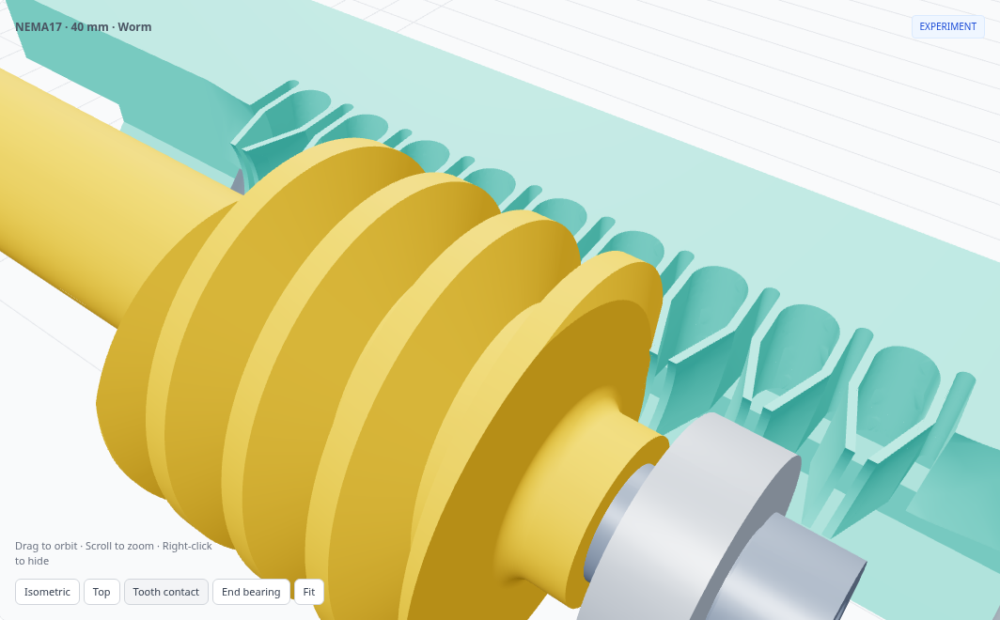
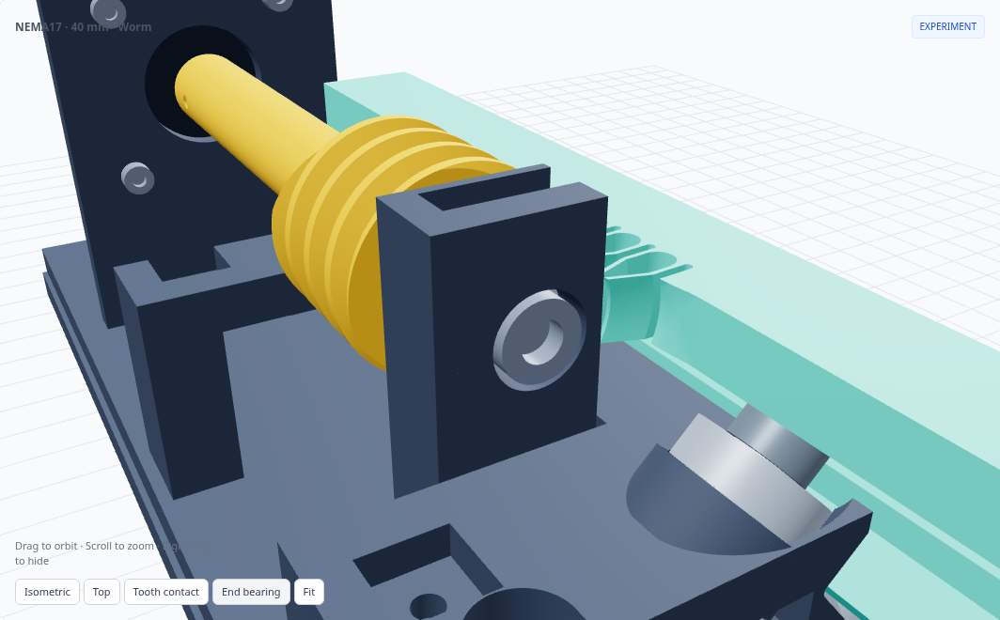
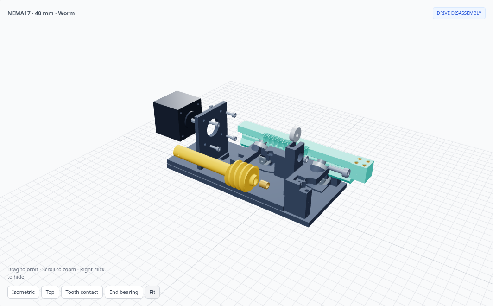

# Worm-to-compliant-rack experiment

**[Open the experimental viewer](https://flex17-compliant-linear-actuator.seveibar.chatgpt.site/experiments/worm-rack/)** · [Production spur actuator](https://flex17-compliant-linear-actuator.seveibar.chatgpt.site/?motor=nema17&stroke=40)

An isolated **NEMA17 / 40 mm stroke** feasibility prototype. This is a direct worm engaging a compliant linear rack. It does not introduce a worm wheel or replace any of the twelve production spur presets. Select **Drive type → Worm rack · experimental** on the 40 mm NEMA17 page.

The prototype has three printed assembly parts: **chassis, rack and a 103 mm one-piece worm**. The worm's integral Ø13 mm stem plugs directly onto the NEMA17's D shaft. At the opposite end, an **axial M5 heat-set insert accepts an M5×16 bolt through a 625ZZ bearing**. The bearing sits in a top-loading saddle with axial shoulders built into the chassis. The motor bracket is also integral.

There is no separate coupling, steel drive shaft, motor cartridge, bearing keeper, keeper screw or shaft collar. The 24 mm active helix stays near the rack; its smooth integral extension clears the rear guide bearings. The 42 × 42 × 40 mm reference motor sits beyond the retracted rack, with its rear controller exposed and unmodeled.

[](https://flex17-compliant-linear-actuator.seveibar.chatgpt.site/experiments/worm-rack/)

## Tooth geometry

| Parameter | Value |
| --- | --- |
| Axial module / pitch | 2 mm / 6.283185 mm |
| Center-section pressure angle | 20° |
| Worm starts / lead | 1 / 6.283185 mm per revolution |
| Worm pitch / outside diameter | 24 / 28 mm |
| One-piece worm length / active helix | 103 / 24 mm |
| Integral stem diameter / motor engagement | 13 / 16 mm |
| Axial M5 insert / pilot | Ø7 × 8 mm / Ø6.6 mm |
| Insert recess / bolt tip clearance | 0.3 / 0.6 mm |
| End bearing seat | Ø16.3 × 5.3 mm, open at the top |
| Rack tooth face | 8 mm |
| Rack oversize | 0.10 mm per flank |
| Worm flank allowance | 0.03 mm per flank |
| Nominal net elastic engagement | 0.07 mm per flank, before printing tolerances |
| Shaft / printed D bore | 5 / 5.30 mm |

The original straight rack cannot simply be reused: its profile does not follow the worm through the tooth thickness. The experiment preserves the **module, 20° axial tooth profile and smooth compliant reliefs at the center plane**, then curves the tooth flanks to match the worm. It retains the lower six-bearing guide rail and original output mount, including its four M3 insert pockets with 3.4 mm clearance holes through the full 18 mm pad. The output inserts are optional: M3 through-bolts, washers and nuts can be used instead.

For a point `(x, y)` in the original rack profile, and worm axis `(Y, Z) = (6, 17)` mm:

```text
r = y − Y
θ = asin((z − Z) / r)
x′ = x + lead / (2π) × θ
y′ = Y + sqrt(r² − (z − Z)²)
```

The mapping is blended back into the rigid backbone above the tooth roots and into the plain rack beyond the tooth field. CAD splines approximate this surface; collision checks evaluate the resulting solids/meshes, not just the formula. Positive rack travel requires negative rotation about the worm's +X axis.

## Resolution

For a 1.8° motor with 200 full steps per revolution:

| Setting | mm per command | µm per command |
| --- | ---: | ---: |
| Full step | 0.031416 | 31.416 |
| Half step | 0.015708 | 15.708 |
| 1/4 step | 0.007854 | 7.854 |
| 1/8 step | 0.003927 | 3.927 |
| 1/16 step | 0.001963 | 1.963 |

These are **command increments**, 18× finer than the 18T spur version. They do not establish positioning accuracy, repeatability, holding force or self-locking. A worm introduces substantial sliding contact; heating, friction, wear and the ability to drive the preloaded teeth are open questions.

## Hardware and assembly

Retain the six 625ZZ rack guide bearings and their M5 axle hardware. The revised drive uses:

- One 625ZZ end bearing, 5 × 16 × 5 mm: **seven bearings total**.
- One M5 heat-set insert, **Ø7 mm outside × 8 mm long**, in the worm's axial Ø6.6 mm pilot. The mouth is recessed 0.3 mm. Match the source dimensions to the insert you buy.
- One **M5×16 socket-head bolt**, passed through the end bearing into the insert. The reference model allows a Ø9.5 × 5 mm head envelope. The bolt has 8 mm insert engagement and 0.6 mm clearance to the pilot bottom.
- One **2 mm metal inner-race spacer**, Ø7.5 mm outside / Ø5.3 mm inside, between the worm end and bearing; one **0.3 mm washer** of the same diameters under the bolt head. These contact the inner race and keep the worm and bolt head clear of the outer race and chassis.
- One **M3×4 flat-point set screw** on the motor shaft flat. Tap the printed Ø2.5 mm radial pilot M3. Its socket remains accessible from the side.
- Four **M3×10 motor screws**; verify engagement with the chosen motor. The reference motor shaft projects 24 mm from its mounting face, with a 0.5 mm-deep D flat.
- Four optional M3 output inserts, Ø4.6 × 5 mm; alternatively use M3 through-bolts, washers and nuts in the output's Ø3.4 mm through-holes.

The printed worm directly engages 16 mm of the motor shaft, with a Ø5.30 mm D socket. Its active helix and rounded compliant rack reliefs retain the original experiment's profile and pitch. The printed stem's torsional stiffness, bolt fit in the bearing and axial play have not been measured.

The end bearing drops in from **+Z**. Its Ø16.3 mm seat and 5.3 mm-wide pocket provide print allowance; integral cheeks retain it axially. The M5 bolt clamps the inner race between the spacer and washer. Snug the bolt without forcing bearing preload, then tighten the motor-shaft set screw with the stack seated. Verify free rotation and axial play on the actual print.

[](https://flex17-compliant-linear-actuator.seveibar.chatgpt.site/experiments/worm-rack/)

Assembly follows the exploded viewer in reverse:

1. Heat-set the axial M5 insert into the worm before installing it in the chassis. Tap the radial M3 pilot.
2. Assemble the six-bearing rack guide and insert the rack. Set it at mid-stroke.
3. Bring the worm in from the side and phase its helix into the compliant rack. Fit the motor shaft into the D socket, then install the four motor screws.
4. Slide the 2 mm spacer through the end block's outer access hole to the worm face. Drop the 625ZZ into the top of the saddle.
5. Install the washer and M5×16 bolt through the bearing into the axial insert. Seat the stack and secure the M3 motor-shaft set screw.
6. Check the complete 40 mm travel by hand before powering the motor; set controller travel limits.

The **Explode drive** slider removes the set screw and end bolt, lifts out the end bearing, removes its spacer, withdraws the motor, and moves the worm sideways out of mesh. The last stage shows the heat-set insert's installation path; removing an installed insert requires heat. Rack guidance stays assembled throughout this sequence.

[](https://flex17-compliant-linear-actuator.seveibar.chatgpt.site/experiments/worm-rack/)

The bundle includes three assembly STLs plus `rack_mesh_coupon.stl`, an assembled STEP, source and the check report. The **chassis STL has unloaded flexure floors**; the viewer shows their installed deflection. The rack is oriented on its tooth face, and the one-piece worm is oriented vertically on its motor end. Use a brim and inspect support requirements in the slicer; the worm's thread flanks are not claimed to print without supports. Use the coupon for an initial tooth-fit check. No physical load, fatigue or wear testing has been performed.

## Reproduce the CAD and checks

From the repository root, using Python 3.12:

```sh
pip install -r experiments/worm-rack/requirements.txt
python experiments/worm-rack/model.py --check
python -m http.server 8000 --directory dist
```

Open `http://localhost:8000/experiments/worm-rack/`. Geometry builds only into `dist/experiments/worm-rack/`; the production `model.py`, presets and downloads are not regenerated. Local B-rep caches live under ignored `work/worm-cache/` and are invalidated when the tooth geometry source changes.

The [validation report](../../dist/experiments/worm-rack/validation.json) records assembled solid intersections, full-stroke motion checks, relative tooth phases, and staged drive disassembly. FCL uses fine CAD tessellation to find moving collision candidates; OCC measures their solid overlap. Selected mesh poses are also checked directly with OCC, including the incompatible straight rack for comparison. Mating insert/host interference and compliant tooth preload are recorded separately. These are sampled geometric checks, not continuous-motion proof, elastic simulation or physical testing.

Before integrating this drive into an enclosure, measure printed fit, available drive force, backlash under load reversals, spring fatigue, wear/temperature and shaft thrust restraint. No performance or self-locking claim is made for this prototype.
